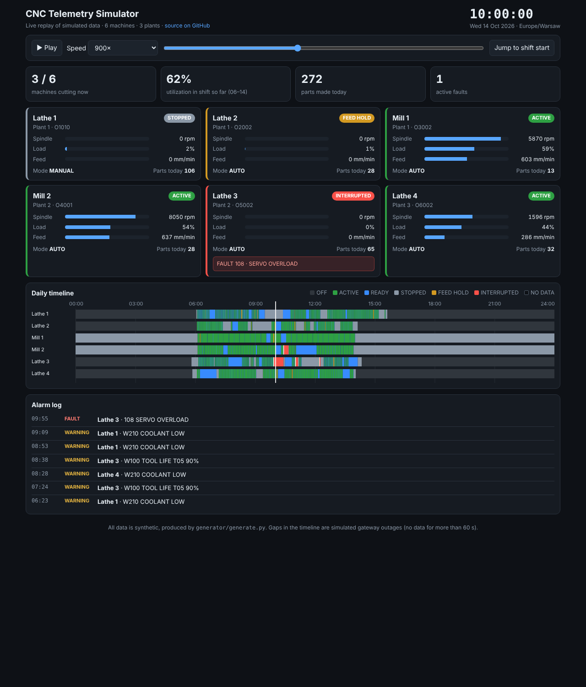

**English** · [Polski](README.pl.md)

# CNC Telemetry Simulator: shop-floor data generator and live demo

**▶ [Live demo](https://bartoszm-analyst.github.io/cnc-telemetry-simulator/)** replays one production day of 6 CNC machines in the browser: machine states, spindle load, feed, alarms, part counts, gateway outages and a daily timeline. No install needed.



## What this is

A reproducible generator of realistic but **entirely synthetic** machine data: 6 lathes and mills across 3 plants and 2 organizations, 30 days of history (about 530,000 events). It exists so that analytics for CNC shops (utilization, downtime, OEE) can be developed and tested without access to a real production floor.

The data deliberately contains the problems real shop-floor data has:

- **Connection gaps.** A plant computer goes offline for minutes or hours. One plant is silent from Friday 2 Oct 15:10 to Monday 5 Oct 6:20. A gap longer than 60 s means "no data", not "machine idle".
- **Night and weekend behavior.** Lathes are powered off at night, mills are left idle; some Saturdays have overtime.
- **Faults and warnings.** Servo overload, tool changer faults, door open during cycle, low coolant, tool life warnings.
- **Operator quality differences.** Machines differ in cycle times, fault rates and idle time between parts.

> Nothing here comes from a real company or production server. There are no user accounts or credentials.

## Quick start

Requires Python 3.9+ (standard library only) and Docker.

```bash
make load    # generate the data and load it into PostgreSQL 16 in Docker
make psql    # open a SQL console
```

Without Docker:

```bash
python3 generator/generate.py data
psql -d cnc_sim -f data/seed.sql
```

The generator uses a fixed seed, so everyone gets identical data. The full dataset (about 35 MB of CSV) is not stored in the repo; `sample/` contains one day (14 Oct 2026) plus the small lookup tables.

## Data model

```
organizations 1──* plants 1──* machines 1──* nc_programs
      │               │            │  └──*  machine_telemetry *──1 nc_programs
      │               │            └─────*  alarm_events
      │               └──1 edge_gateways
      └──* shift_schedules
```

| Table | Contents |
|---|---|
| `organizations`, `plants` | Companies and their production halls (with time zone) |
| `machines` | CNC machines: code, name, type (`lathe`/`mill`), max spindle speed |
| `nc_programs` | NC programs per machine with the ideal cycle time in seconds (for OEE performance) |
| `shift_schedules` | One row per organization and weekday: shift start and end in local time |
| `machine_telemetry` | Readings, one row per state change plus one every 30 s. Typed columns: `execution_state`, `control_mode`, `program_id`, `part_counter`, `spindle_rpm`, `spindle_load_pct`, `feedrate`, override percentages |
| `alarm_events` | One row per alarm episode: severity (`FAULT`/`WARNING`), code, message, `raised_at`, `cleared_at` |
| `edge_gateways` | Latest report of each plant's data collection computer |

Schema: [`generator/schema.sql`](generator/schema.sql). `execution_state` is one of `ACTIVE`, `READY`, `STOPPED`, `FEED_HOLD`, `INTERRUPTED`. When `is_available` is false the machine is off or unreachable and the measurement columns are `NULL`.

## Example queries

[`sql/shift_utilization.sql`](sql/shift_utilization.sql) computes the share of time each machine spends cutting during planned shifts. The shift windows come from `shift_schedules` and are converted to each plant's local time. Each reading lasts until the next one, capped at 60 s, so outages are not counted as production. It uses a window function (`lead`), a conditional aggregate (`FILTER`) and joins across four tables.

Result on the generated data:

| machine | cutting % |
|---|---|
| Lathe 1 | 41 |
| Lathe 2 | 62 |
| Mill 1 | 71 |
| Mill 2 | 70 |
| Lathe 3 | 37 |
| Lathe 4 | 58 |

[`sql/alarm_summary.sql`](sql/alarm_summary.sql) counts faults and warnings per machine, total fault hours and the most common alarm.

## Browser demo

`docs/` is a static site (GitHub Pages) in plain HTML and JavaScript with no libraries. It replays the day in `sample/` at an adjustable speed (60x to 3600x), with a scrubber and a clickable timeline. `docs/demo-data.js` is built from the sample by `python3 tools/build_demo_data.py`. To run it locally, open `docs/index.html`.

This is a replay of generated data, not a connection to real machines.

## Repository layout

```
generator/   data generator and PostgreSQL schema
sample/      one day of telemetry and alarms plus the lookup tables (CSV)
sql/         example analytics queries
docs/        browser demo (GitHub Pages)
tools/       builds the demo data file from the sample
.github/     CI: generates the data and loads it into PostgreSQL on every push
```

## Roadmap

- Streaming mode: the generator emits events in real time (FastAPI and WebSocket) and the dashboard consumes them live.
- Full OEE (availability, performance via `cycle_targets`, quality) as SQL views.
- Downtime reason analysis built on `alarm_events`.

## About

Built by Bartosz Majka. About 10 years of CNC programming and production engineering, now moving into data engineering and building IoT analytics for Polish CNC manufacturers. [LinkedIn](https://www.linkedin.com/in/bartosz-majka)
