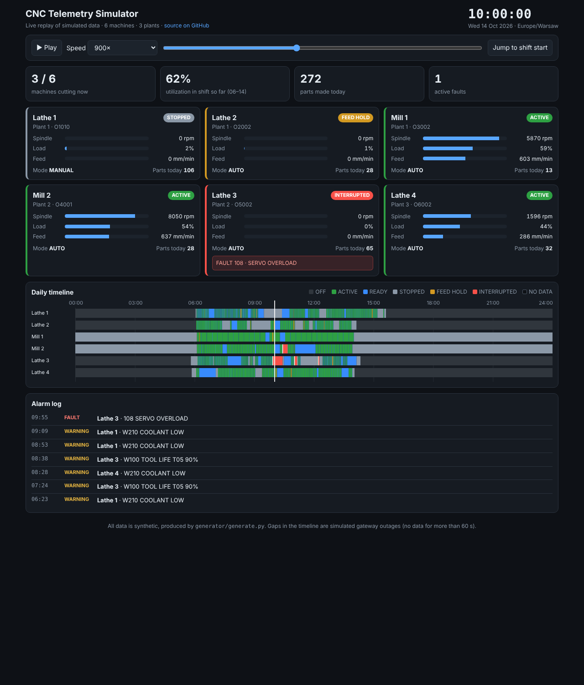

[English](README.md) · **Polski**

# CNC Telemetry Simulator – generator danych z hali CNC i demo na żywo

**▶ [Live demo](https://bartoszm-analyst.github.io/cnc-telemetry-simulator/)** – pulpit odtwarzający na żywo dobę pracy 6 maszyn CNC (stany, obroty, obciążenie, alarmy, przerwy w łączności, oś czasu). Działa w przeglądarce, bez instalacji.



Generator realistycznych (ale w całości **fikcyjnych**) danych z hali produkcyjnej: 6 tokarek i frezarek, 3 hale, 30 dni historii (~530 tys. zdarzeń). Dane mają ten sam format, co odczyty z maszyn CNC (stan wykonania, tryb, alarmy, obroty wrzeciona, obciążenie, posuw, licznik sztuk) i służą do rozwijania oraz testowania analizy pracy maszyn (czas pracy, przestoje, OEE) bez dostępu do prawdziwej produkcji.

> Nic tu nie pochodzi od klienta ani z serwera produkcyjnego. Nie ma kont użytkowników ani haseł.

## Szybki start

Wymagania: Python 3.9+, Docker.

```bash
make load      # generuje dane i wczytuje je do PostgreSQL 16 w Dockerze
make psql      # konsola SQL
```

Bez Dockera: `python3 generator/generate.py data`, potem `psql -d cnc_sim -f data/seed.sql`.

Generator jest **deterministyczny** (stałe ziarno) – każdy dostaje identyczne dane. Pełny zestaw (~200 MB) nie jest w repozytorium; w `sample/` jest jedna doba (14.10.2026) i małe tabele słownikowe.

## Demo w przeglądarce

`docs/` to statyczna strona (GitHub Pages) – czysty HTML/JS, bez bibliotek. Dane pochodzą z `sample/` (doba 14.10.2026) i są zamieniane na `docs/demo-data.js` przez `python3 tools/build_demo_data.py`. Lokalnie: otwórz `docs/index.html`.

## Model danych

```
organizations 1──* plants 1──* machines 1──* nc_programs
      │               │            │  └──*  machine_telemetry *──1 nc_programs
      │               │            └─────*  alarm_events
      │               └──1 edge_gateways
      └──* shift_schedules
```

`organizations` i `plants` (firmy i hale, ze strefą czasową), `machines`, `nc_programs` (wzorcowy czas cyklu do OEE), `shift_schedules` (zmiany: jeden wiersz na firmę i dzień tygodnia), `machine_telemetry` (odczyty w typowanych kolumnach: stan, tryb, program, licznik sztuk, obroty, obciążenie, posuw), `alarm_events` (epizody alarmów), `edge_gateways`. Schemat: [`generator/schema.sql`](generator/schema.sql).

Wiersz telemetrii powstaje przy każdej zmianie stanu oraz co 30 s. **Brak łączności** = przerwa w danych > 60 s. Dane celowo ją zawierają (np. `plant-3` milczy od piątku 2.10 15:10 do poniedziałku 5.10 6:20), żeby analiza musiała sobie z tym radzić.

## Przykłady

[`sql/shift_utilization.sql`](sql/shift_utilization.sql): % czasu pracy w zmianach na maszynę (okna zmian z tabeli `shift_schedules`). [`sql/alarm_summary.sql`](sql/alarm_summary.sql): awarie i ostrzeżenia na maszynę.
